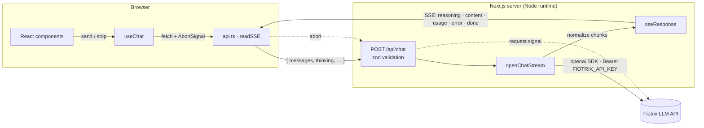

# Persian Chat — streaming LLM UI

A right-to-left, Persian chat interface for an OpenAI-compatible LLM API (`qwen3.5-35b-a3b` on Fiotrix).
Answers stream token by token, the model's reasoning is shown live while it thinks, and every reply
carries its own latency and throughput metrics. The API key never leaves the server.

> **Screenshots** — _coming soon_
>
> | Dark (default) | Light | Mobile (375px) |
> | --- | --- | --- |
> | `docs/screenshot-dark.png` | `docs/screenshot-light.png` | `docs/screenshot-mobile.png` |

## Features

- **Token streaming** over Server-Sent Events, with **Stop** that cancels generation upstream, not just in the UI.
- **Live thinking panel** — "در حال فکر کردن…" while reasoning streams, then collapses to "فکر کرد برای X ثانیه".
  Thinking can be toggled per request.
- **Per-message metrics** — time to first token, total time, tokens/sec, prompt and completion tokens.
- **Markdown** with GFM tables, syntax-highlighted code blocks (always LTR), copy buttons on code and messages.
- **Context management** — history is estimated against the 32K window; the oldest turns are dropped
  (system prompt kept) with a subtle notice.
- **Friendly errors** — every documented API error code maps to a Persian message and the right action:
  retry (with a `Retry-After` countdown), start a new chat, or nothing the user can do.
- **Settings drawer** — system prompt, temperature, max tokens, new chat.
- RTL throughout, mixed-direction text handled per paragraph, dark theme by default with a persisted toggle,
  keyboard accessible, responsive down to 375px.

## Quick start

Requires Node.js 20.9+ (tests use Node's built-in TypeScript support: 22.18+ / 24).

```bash
npm install
cp .env.example .env.local   # then put your key in FIOTRIX_API_KEY
npm run dev                  # http://localhost:3000
```

| Variable | Required | Default |
| --- | --- | --- |
| `FIOTRIX_API_KEY` | yes | — (starts with `fx-`) |
| `FIOTRIX_BASE_URL` | no | `https://ai.fiotrix.com/v1` |
| `FIOTRIX_MODEL` | no | `qwen3.5-35b-a3b` |

| Script | |
| --- | --- |
| `npm run dev` / `build` / `start` | Next.js |
| `npm run lint` | ESLint (flat config, `next/core-web-vitals` + TypeScript) |
| `npm run typecheck` | `tsc --noEmit`, strict |
| `npm test` | `node --test` — SSE parser, history trimming, metrics |

## Architecture



A single request, end to end:

1. `useChat` trims the history to fit the context budget and POSTs it to `/api/chat`.
2. The route validates the body with zod, prepends the system prompt and calls the model with
   `stream: true`, `stream_options.include_usage` and `chat_template_kwargs.enable_thinking`.
   With thinking on, `max_tokens` is raised to at least 2048, because thinking tokens count as output.
3. Upstream chunks are normalized into a small event contract (`src/core/chat/events.ts`):
   `delta.reasoning` → `reasoning`, `delta.content` → `content` (leading blank line trimmed),
   the final usage chunk → `usage`, then `done`.
4. The response is a pull-based `ReadableStream`: a chunk is read from upstream only when the client
   is ready for it, so nothing is buffered on the server.
5. The browser parses SSE from the fetch body, validates each event against the same zod schema, and
   updates the message — timing first token, reasoning duration and total time as events arrive.

**Stop** aborts the `fetch`; the server sees `request.signal` abort, and the SDK cancels the upstream
request, so the model stops generating rather than running on unobserved.

### Why a server-side proxy?

- **The key stays secret.** Anything shipped to the browser is public. The key is read only in
  `src/core/llm/client.ts`, which imports `server-only`, so the build fails if client code ever imports it.
  There's no `NEXT_PUBLIC_` variable and no SDK in the client bundle.
- **One place for policy.** Validation, payload limits, the thinking/`max_tokens` rule and the system
  prompt are enforced server-side, where the user cannot bypass them.
- **A stable contract.** The UI depends on five normalized event types, not on a provider's chunk format
  or its non-standard `reasoning` field. Swapping providers touches one file.
- **Errors are normalized.** SDK and upstream errors become `{ code, message, retryAfter? }`, with the
  real HTTP status before streaming and an `error` event after it. The client branches on `code`, never on text.

### Error handling

| Code | Shown to the user | Action |
| --- | --- | --- |
| `rate_limited` | Too many requests — try again in a few seconds | Retry, after the `Retry-After` countdown |
| `quota_exceeded` | Monthly quota used up | — |
| `context_length_exceeded` | The conversation outgrew the model's memory | Start a new chat |
| `upstream_error`, `model_maintenance`, `model_unavailable`, `upstream_timeout` | Temporary service problem | Retry |
| `invalid_api_key`, `model_not_allowed`, `ip_not_allowed`, `model_not_found` | Configuration problem (admin) | — |
| `invalid_request`, `network_error`, `unknown_error` | Generic | Retry |

`429/502/503/504` are first retried by the SDK itself (`maxRetries: 2`, honoring `Retry-After`).

## Project structure

```
src/
  app/
    api/chat/route.ts     the proxy: validate → stream → SSE
    layout.tsx  page.tsx  globals.css
  core/                   shared by server and client
    chat/                 event contract, request schema, limits, error codes
    llm/                  server-only: SDK client, chunk normalizer, SSE response, error mapping
  features/chat/
    ChatPage.tsx          composition only
    hooks/                useChat (streaming, abort, metrics), useChatSettings, useAutoScroll
    components/           header/ messages/ composer/ settings/
    api.ts  errors.ts  utils.ts  format.ts  types.ts  constants.ts
  shared/
    ui/                   IconButton, CopyButton, Switch, Drawer, Field, SliderField
    hooks/                useTheme, useCopyToClipboard, useCountdown
    lib/sse.ts            SSE reader/encoder for fetch streams
    theme/                theme storage key + pre-paint script
```

## Reading guide

A suggested order if you are studying the code. Each step is small enough to read in one sitting.

1. `src/core/chat/events.ts` and `schema.ts` — the two contracts everything else depends on:
   the SSE event types and the request body.
2. `src/app/api/chat/route.ts` (31 lines) — the whole server entry point.
3. `src/core/llm/streamChat.ts` — turns the provider's chunks into the normalized events.
4. `src/core/llm/sseResponse.ts` and `src/shared/lib/sse.ts` — the two ends of the SSE pipe.
5. `src/features/chat/hooks/useChat.ts` — the client state machine: send, stream, stop, metrics, errors.
6. `src/features/chat/ChatPage.tsx` — composition only; follow its children for the UI.
7. `*.test.ts` files — run `npm test` to see the SSE parser, history trimming and text-direction rules pinned down.

Concepts worth looking up while reading: Server-Sent Events over `fetch` streams, `AbortSignal`
propagation, pull-based `ReadableStream` backpressure, `server-only` boundaries in Next.js, and
bidirectional text (`dir="auto"`) in RTL layouts.

## Design decisions

- **One cast.** `delta.reasoning` is not in the OpenAI types; it is read through a single documented
  type extension in `src/core/llm/streamChat.ts`. Everything crossing the network is otherwise validated.
- **Token estimate is a heuristic.** `chars / 3`, deliberately pessimistic for Persian, plus a safety
  margin. Replacing it with the model's real tokenizer is the upgrade path if trimming proves too eager.
- **Native over custom.** `<dialog>` for the drawer (focus trap, Esc, backdrop), `<details>` for the
  thinking panel, `field-sizing: content` for the auto-growing composer.
- **No theme flash.** The server renders the default dark theme; a tiny inline script switches to light
  before first paint if that was the stored choice. Storage access is wrapped in `try/catch`.
- **Cache Components is off.** Next 16 rejects an explicit `runtime` export with it enabled, and this
  page has nothing to cache.

## Tech

Next.js 16 (App Router) · React 19 · TypeScript (strict) · Tailwind CSS 4 · `openai` SDK · zod ·
react-markdown + remark-gfm + rehype-highlight · lucide-react · Vazirmatn
